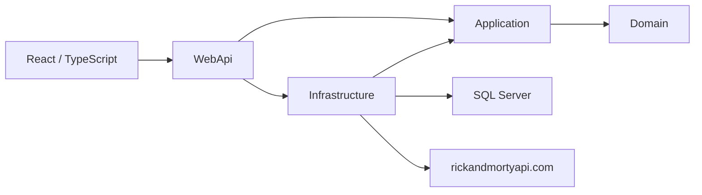

# TodoCharacters

TodoCharacters is a full-stack to-do list with a Rick and Morty character browser: a .NET 8 Web API in Clean Architecture, a React and TypeScript client, SQL Server, and tests from domain rules through the browser.

## About this project

This repository was built as a take-home technical challenge for a job selection process. The hiring company is not named here, and the original brief is not in the tree.

The brief asked for a SQL Server to-do API and a read-only integration with the public Rick and Morty API: .NET 8, Clean Architecture, a Portuguese JSON contract, a React and TypeScript client, and unit, integration, architecture, functional, and end-to-end tests. The rules implemented from that brief are one level of subtasks, the statuses `Não iniciado`, `Em progresso`, and `Concluído`, a block on completing a parent while a subtask is open, cascade delete of subtasks, UTC timestamps, and `Result` values instead of exceptions for validation and business failures. The character client counts episodes from the upstream array, normalizes missing text, hides upstream pagination URLs, and returns an empty page or HTTP 503 when the external API cannot be used.

Authentication, task sorting, an in-memory character cache, a link from a task to a character, and a CI pipeline are outside that MVP. A client-side status filter was added as an optional extra. The code is the showcase of the stack: .NET 8, Clean Architecture, EF Core, SQL Server, React, TypeScript, and Playwright.

C# identifiers are English. The HTTP contract for tasks and characters uses Portuguese names (`titulo`, `status`, `criadaEm`, `nome`, `quantidadeEpisodios`). The sections below were checked against the code in this repository. The original Portuguese README is preserved under [Português](#português).

## Features

**Tasks**

- Create a root task and one level of subtasks. A subtask cannot own another subtask.
- Update the title and description. The API accepts both fields; the React screen edits the title inline and displays a description when the API returns one.
- Move a task through `Não iniciado`, `Em progresso`, and `Concluído`.
- Block completion of a root task while any subtask is still open.
- Stamp `concluidaEm` in UTC when a task is completed, and clear it when the task leaves `Concluído`.
- Reopen a completed parent to `Em progresso` when one of its completed subtasks leaves `Concluído`.
- Delete a task and its subtasks in one `SaveChanges` call.
- List root tasks in two groups, `ativas` and `concluidas`, ordered by creation time.
- Filter those groups in the browser. `GET /api/tasks` has no status query parameter.

**Characters**

- Browse the public [Rick and Morty API](https://rickandmortyapi.com/) one page at a time, in a grid or a list.
- Open a character for status, species, gender, origin, location, image, and episode count.
- Treat an upstream HTTP 404 for a page as an empty page.
- Return **503** when the upstream call times out or fails.
- In the `Testing` environment, serve characters from an in-process fake. End-to-end tests never call the public API.

**Host**

- Minimal APIs, Swagger in Development, and CORS for the Vite dev server (`http://localhost:5173` and `http://127.0.0.1:5173`).
- The React app is a single page with `/tarefas`, `/personagens`, and `/personagens/:id`. `/` redirects to `/tarefas`.

There is no authentication, no multi-user model, no CI workflow, no server-side task sort, no character cache, and no link between a task and a character. The stylesheet is intentionally small. The API exposes `DELETE /api/tasks/{id}`; the React screens do not.

## Architecture



| Project | Responsibility |
| --- | --- |
| `TodoCharacters.Domain` | `TaskItem`, task status, and domain results. No project references. |
| `TodoCharacters.Application` | MediatR commands and queries, FluentValidation, the `Result` type, and ports `ITaskRepository` and `ICharacterApiClient`. References Domain only. |
| `TodoCharacters.Infrastructure` | EF Core SQL Server, the task repository, the migration, and `RickAndMortyClient`. References Application. |
| `TodoCharacters.WebApi` | Composition root, minimal API endpoints, Swagger, CORS, and `FakeCharacterApiClient`. References Application and Infrastructure. |

A request enters a minimal API endpoint, becomes a MediatR request, passes through `ValidationBehavior`, and is handled by an application handler. Handlers return `Result` or `Result<T>`. `ResultToHttpMapper` turns that into HTTP:

| `ErrorType` | Status |
| --- | --- |
| Validation | 400 |
| NotFound | 404 |
| Conflict | 409 |
| ExternalService | 503 |

The JSON error body is `{ "code", "message" }`. A successful create returns **201** with a `Location` of `/api/tasks/{id}`. A successful delete returns **204**.

`Program.cs` chooses the database when the host starts:

- `ASPNETCORE_ENVIRONMENT=Testing` uses the InMemory database `TodoCharactersE2E` and `FakeCharacterApiClient`. Migrations do not run, and Swagger stays off.
- Development tries `ConnectionStrings:DefaultConnection`. When SQL Server accepts the connection, the host registers EF Core SQL Server and the live Rick and Morty client, then calls `Database.MigrateAsync`.
- When that connection fails in Development, the host logs a warning and uses the InMemory database `TodoCharactersDev`. Character calls still go to the public API. Task data lives only for that process.

The checked-in migration `InitialCreate` creates `Tasks` with `datetimeoffset` timestamps and a self-referencing foreign key. The foreign key has no SQL `ON DELETE CASCADE`.

## HTTP API

Status values are the Portuguese labels `Não iniciado`, `Em progresso`, and `Concluído`.

| Method | Path | Success | Typical failures |
| --- | --- | --- | --- |
| `GET` | `/api/tasks` | 200 `{ ativas, concluidas }` | |
| `POST` | `/api/tasks` | 201 task | 400 title or description, 404 unknown `tarefaPaiId`, 409 subtask of a subtask |
| `PUT` | `/api/tasks/{id}` | 200 task | 400, 404. Title and description only. |
| `PATCH` | `/api/tasks/{id}/status` | 200 task | 400 unknown status, 404, 409 parent still has an open subtask |
| `DELETE` | `/api/tasks/{id}` | 204 | 404 |
| `GET` | `/api/characters?page={n}` | 200 page | 503 upstream unavailable. `page` below 1 is treated as 1. |
| `GET` | `/api/characters/{id}` | 200 detail | 404 unknown character, 503 upstream unavailable |

Task JSON uses `id`, `titulo`, `descricao`, `status`, `criadaEm`, `concluidaEm`, `tarefaPaiId`, and `subtarefas`. A page of characters uses `items`, `page`, `totalPages`, `totalCount`, `hasNext`, and `hasPrev`. Summary items use `id`, `nome`, `status`, `especie`, and `imagemUrl`. Detail adds `genero`, `origem`, `localizacao`, and `quantidadeEpisodios`. Origin and location keep the upstream name only. Episode URLs are counted and dropped. The character image URL is copied into `imagemUrl`.

`appsettings.json` points the client at the public API with a 10-second timeout:

```json
"RickAndMortyApi": {
  "BaseUrl": "https://rickandmortyapi.com/api/",
  "TimeoutSeconds": 10
}
```

## Testing strategy

Every test project targets `net8.0` and xUnit. Unit, integration, and functional tests also use FluentAssertions. Handler tests use Moq. Architecture tests use NetArchTest.Rules.

| Project | What it exercises |
| --- | --- |
| `TodoCharacters.ArchitectureTests` | Domain and Application assemblies must not depend on Infrastructure or WebApi. |
| `TodoCharacters.UnitTests` | Task creation, completion, reopening, subtask depth, validation `Result`s, the parent-status rollback, and `CharacterMapper` (episode count, `"unknown"`, empty strings). |
| `TodoCharacters.IntegrationTests` | `DeleteParentTaskCascadeTests` talks to SQL Server. `CharacterApiIntegrationTests` boots the API with WebApplicationFactory, swaps in an InMemory database and a fake character client, and checks that the JSON page contains `items` and `hasNext` and contains no `rickandmortyapi.com` URL. |
| `TodoCharacters.FunctionalTests` | WebApplicationFactory over the API: invalid title returns 400, completing a parent with an open subtask returns 409, and a failing character client returns 503. |
| `web/todo-characters-web/e2e` | Playwright drives the Vite app against the API in `Testing`. The suite creates a task and subtask, completes them, blocks a parent with an open subtask, pages through the fake characters, and renames a task inline. |

`DeleteParentTaskCascadeTests` returns without running its assertion when `MSSQL_SA_PASSWORD` is unset or SQL Server cannot be reached. The test still passes. Set the variable and start the container when you want that assertion to run.

The functional and integration projects reference WireMock.Net. The tests in the repository use hand-written `ICharacterApiClient` fakes.

`appsettings.Testing.json` contains a LocalDB connection string and a dummy Rick and Morty URL. The `Testing` host does not use either setting: `Program.cs` forces InMemory and `FakeCharacterApiClient`.

```bash
dotnet test tests/TodoCharacters.ArchitectureTests
dotnet test tests/TodoCharacters.UnitTests
dotnet test tests/TodoCharacters.IntegrationTests
dotnet test tests/TodoCharacters.FunctionalTests

cd web/todo-characters-web
npm install
npx playwright install chromium
npm run test:e2e
```

`npm run test:e2e` starts the API with `ASPNETCORE_ENVIRONMENT=Testing` on `http://localhost:5000` and Vite on `http://localhost:5173`. `npm run lint` runs oxlint. `npm run build` typechecks with `tsc` and builds the Vite bundle.

## Design decisions

### Cascade delete on a self-referencing foreign key

SQL Server rejects `ON DELETE CASCADE` on `ParentTaskId` because the self-reference produces multiple cascade paths. `TaskItemConfiguration` uses `DeleteBehavior.ClientCascade`. With the children loaded, EF Core deletes them in the same `SaveChanges` as the parent. The migration's foreign key has no database cascade. `DeleteParentTaskCascadeTests` covers that path on SQL Server.

### Validation returns a `Result`

The default FluentValidation MediatR behavior throws `ValidationException`. `ValidationBehavior<TRequest,TResponse>` runs the validators and, on failure, builds a `Result<T>` through `IResultFactory` (reflection over `Result<T>.Failure`) with code `VALIDATION_ERROR`. `CreateTaskCommandValidator`, `UpdateTaskCommandValidator`, and `ChangeTaskStatusCommandValidator` cover the request shapes. `TaskItem` still throws `ArgumentException` for a title outside 3–120 characters or a description over 1,000 characters; the create and update handlers catch it and return the same kind of validation `Result`. `ValidationBehaviorTests` and `TaskHandlerTests` cover the pipeline and the handler.

### Episode count and missing character fields

`quantidadeEpisodios` is `episode.Count` on the upstream array of episode URLs. The upstream API sends `"unknown"` or `""` for missing optional text. `CharacterMapper.NormalizeOptional` maps a blank value or `"unknown"` (any casing) to `"unknown"`, and otherwise returns the original string. `CharacterMapperTests` covers the episode count, `"unknown"`, and empty strings.

### A page past the end of the catalog

`RickAndMortyClient.GetCharactersAsync` turns an upstream **404** into an empty page: no items, `hasNext: false`, and `hasPrev` only when the requested page is greater than 1. A **404** for a single character becomes a null client result and then HTTP **404** with code `PERSONAGEM_NAO_ENCONTRADO`.

### Pagination without upstream URLs

The public API expresses next and previous as absolute URLs. The adapter keeps only booleans. The internal page is `{ items, page, totalPages, totalCount, hasNext, hasPrev }`. `hasNext` and `hasPrev` follow whether `info.next` and `info.prev` are non-empty. `CharacterApiIntegrationTests` checks that shape on a fake client whose payload has no `rickandmortyapi.com` host.

### UTC timestamps

`CreatedAt` and `CompletedAt` are `DateTimeOffset`. New tasks take `DateTimeOffset.UtcNow`. Completing a task sets `CompletedAt` to `DateTimeOffset.UtcNow`; any other status clears it. SQL Server stores the columns as `datetimeoffset`. `TaskItemTests.CreateRoot_should_start_as_NaoIniciado_with_utc_timestamp` covers the initial state.

### Upstream timeout and transport failures

A timeout (`TaskCanceledException`), an `HttpRequestException`, or any non-success status other than the page **404** becomes `ExternalApiException` with code `EXTERNAL_API_UNAVAILABLE`. The character handlers map that to `ErrorType.ExternalService`, and the HTTP mapper returns **503**. `GET_characters_when_external_api_fails_returns_503` covers the mapper path with a failing client.

### Reopening a completed parent

When a subtask moves from `Concluído` to another status, `ChangeTaskStatusCommandHandler` loads the parent and calls `ReopenFromCompleted`. A completed parent becomes `Em progresso` and loses `concluidaEm`. A parent that was not completed stays as it is. `ChangeTaskStatusCommandHandlerTests.Deve_reverter_pai_para_em_progresso_quando_subtarefa_deixa_de_ser_concluida` covers the rollback. The domain rule that a parent cannot be completed while a subtask is open is a **409** with code `TAREFA_PAI_SUBTAREFAS_PENDENTES`.

### A subtask of a subtask

`TaskItem.CreateSubtask` fails when the parent already has a `ParentTaskId`. The handler returns **409** with code `SUBTAREFA_PROFUNDIDADE_MAXIMA`. The body is valid JSON, and a missing parent is a different outcome: **404** `TAREFA_PAI_NAO_ENCONTRADA`. `CreateTaskCommandHandlerTests.Subtask_in_subtask_should_return_conflict` covers the depth rule.

### Status filter lives in the React app

`GET /api/tasks` returns every root task, already split into `ativas` and `concluidas`. `/tarefas` filters that payload with `Todos`, `Não iniciado`, `Em progresso`, and `Concluído`. The "Fila principal" section is omitted when the filter is `Concluído`. The "Concluídas" section is omitted when the filter is `Não iniciado` or `Em progresso`. The filter compares each root task's status. Implementation: `web/todo-characters-web/src/pages/TasksPage.tsx`.

### Other choices

| Topic | Decision |
| --- | --- |
| Active queue | Root tasks that are not `Concluído`, shown as "Fila principal", ordered by `CreatedAt` |
| Unknown parent id | 404 |
| `PUT /api/tasks/{id}` | Title and description only |
| Language | English in C#; Portuguese in the task and character JSON |
| Development without SQL Server | InMemory database `TodoCharactersDev`, live character API, warning on stdout |
| End-to-end and `Testing` | InMemory database `TodoCharactersE2E` and `FakeCharacterApiClient` |
| CSS | Small functional stylesheet |

## How to run

Prerequisites:

- .NET 8 SDK
- Node.js 20.19+ or 22.12+ (the range Vite declares in the lockfile)
- Docker with Compose, only if you want SQL Server persistence

The solution file is `TodoCharacters.slnx`. The commands below target each `.csproj`, which the .NET 8 SDK can build directly.

### API and UI without SQL Server

```bash
dotnet run --project src/TodoCharacters.WebApi/TodoCharacters.WebApi.csproj
```

The `http` launch profile listens on `http://localhost:5000` with `ASPNETCORE_ENVIRONMENT=Development`. Swagger is at `http://localhost:5000/swagger`. If SQL Server is unreachable, the console warning says the host is using InMemory. Characters still load from the public API.

```bash
cd web/todo-characters-web
npm install
npm run dev
```

The UI is at `http://localhost:5173`. Vite proxies `/api` to `http://localhost:5000`. Set `VITE_API_URL` to override that base; the client defaults to `/api`.

### SQL Server

The SA password is not stored in the repository. Copy the example env file, replace the placeholder with a strong local password, and pass the same value to the API. SQL Server requires at least eight characters with uppercase, lowercase, a digit, and a symbol.

```bash
cp .env.example .env
# Edit MSSQL_SA_PASSWORD in .env, then load it:
set -a
source .env
set +a

docker compose up -d

export ConnectionStrings__DefaultConnection="Server=localhost,1433;Database=TodoCharacters;User Id=sa;Password=${MSSQL_SA_PASSWORD};TrustServerCertificate=True"
dotnet run --project src/TodoCharacters.WebApi/TodoCharacters.WebApi.csproj
```

PowerShell:

```powershell
Copy-Item .env.example .env
# Edit MSSQL_SA_PASSWORD in .env, then:
Get-Content .env | ForEach-Object {
  if ($_ -match '^\s*#' -or $_ -notmatch '=') { return }
  $name, $value = $_.Split('=', 2)
  Set-Item -Path "Env:$($name.Trim())" -Value $value.Trim()
}

docker compose up -d

$env:ConnectionStrings__DefaultConnection = "Server=localhost,1433;Database=TodoCharacters;User Id=sa;Password=$env:MSSQL_SA_PASSWORD;TrustServerCertificate=True"
dotnet run --project src/TodoCharacters.WebApi/TodoCharacters.WebApi.csproj
```

`ConnectionStrings__DefaultConnection` overrides the placeholder in `appsettings.json` and `appsettings.Development.json`. On a successful connection the API applies `InitialCreate` by itself. A manual `dotnet ef database update` is unnecessary for this startup path.

The cascade integration test uses the same `MSSQL_SA_PASSWORD` variable and the database `TodoCharacters_Test` on `localhost,1433`:

```bash
export MSSQL_SA_PASSWORD='your-local-password'
dotnet test tests/TodoCharacters.IntegrationTests
```

## Repository layout

```
src/TodoCharacters.Domain
src/TodoCharacters.Application
src/TodoCharacters.Infrastructure
src/TodoCharacters.WebApi
tests/TodoCharacters.ArchitectureTests
tests/TodoCharacters.UnitTests
tests/TodoCharacters.IntegrationTests
tests/TodoCharacters.FunctionalTests
web/todo-characters-web          React client and Playwright tests
TodoCharacters.slnx
docker-compose.yml
```

There is no `docs/` directory in this repository.

## License

[MIT](LICENSE). Copyright (c) 2026 Roniedson de Souza Valadares Silva.

## Português

### Sobre este projeto

Este repositório foi feito como desafio técnico (take-home) de um processo seletivo. A empresa não é nomeada aqui, e o enunciado original não está na árvore.

O enunciado pedia uma API de tarefas em SQL Server e uma consulta somente leitura à API pública de Rick and Morty: .NET 8, Clean Architecture, contrato JSON em português, cliente React e TypeScript, e testes de unidade, integração, arquitetura, funcionais e de ponta a ponta. As regras implementadas a partir desse enunciado são um nível de subtarefas, os status `Não iniciado`, `Em progresso` e `Concluído`, o bloqueio da conclusão do pai com subtarefa em aberto, exclusão em cascata, timestamps em UTC e `Result` no lugar de exceção para falhas de validação e de negócio. O cliente de personagens conta episódios pelo array da API externa, normaliza texto ausente, esconde as URLs de paginação externas e devolve página vazia ou HTTP 503 quando a API externa não pode ser usada.

Autenticação, ordenação de tarefas, cache em memória de personagens, vínculo entre tarefa e personagem e pipeline de CI ficam fora desse MVP. O filtro de status no cliente entrou como diferencial opcional. O código é a amostra da stack: .NET 8, Clean Architecture, EF Core, SQL Server, React, TypeScript e Playwright.

O texto a seguir é o README original, preservado de propósito.

A senha do SQL Server local não fica mais no repositório. Para subir o banco, siga [How to run](#how-to-run). Com o SQL Server acessível, a API aplica as migrations sozinha na inicialização. Em Development, se o SQL Server não responder, a API usa um banco InMemory e escreve um aviso no console. A pasta `docs/` citada no final desta seção não está no repositório.

---

# TodoCharacters

Aplicação full-stack de to-do list com consulta de personagens Rick and Morty. Clean Architecture (.NET 8) + React/TypeScript.

## Pré-requisitos

- .NET 8 SDK
- Node.js 20+
- Docker Desktop (SQL Server local)

## Início rápido

```powershell
# 1. Banco de dados
docker compose up -d

# 2. API (aplicar migrations manualmente se dotnet-ef falhar)
# Opção A: dotnet ef database update -p src/TodoCharacters.Infrastructure -s src/TodoCharacters.WebApi
# Opção B: migrations já versionadas em src/TodoCharacters.Infrastructure/Persistence/Migrations

dotnet run --project src/TodoCharacters.WebApi/TodoCharacters.WebApi.csproj

# 3. Frontend
cd web/todo-characters-web
npm install
npm run dev
```

- API: http://localhost:5000/swagger (Development)
- Web: http://localhost:5173

## Comandos de teste

```powershell
dotnet test tests/TodoCharacters.ArchitectureTests
dotnet test tests/TodoCharacters.UnitTests
dotnet test tests/TodoCharacters.IntegrationTests
dotnet test tests/TodoCharacters.FunctionalTests

cd web/todo-characters-web
npm run test:e2e   # usa ASPNETCORE_ENVIRONMENT=Testing (InMemory + FakeCharacterApi)
```

## Configuração Rick and Morty API

`appsettings.json`:

```json
"RickAndMortyApi": {
  "BaseUrl": "https://rickandmortyapi.com/api/",
  "TimeoutSeconds": 10
}
```

Para testes E2E e ambiente `Testing`, a API usa `FakeCharacterApiClient` — **nunca depende da API externa real**.

---

## Decisões e inconsistências do enunciado

Esta seção documenta pegadinhas, lacunas do PDF e como foram resolvidas.

### Cascade delete self-reference (SQL Server)

**Inconsistência / pegadinha:** `DeleteBehavior.Cascade` na FK `tarefaPaiId` faz o SQL Server rejeitar a migration (*cycles or multiple cascade paths*).

**Opções consideradas:**
- `DeleteBehavior.Cascade` (SQL) — rejeitado pelo banco
- Cascade manual no handler — funciona, mais código
- **`DeleteBehavior.ClientCascade`** — EF deleta filhos na mesma transação

**Decisão adotada:** `ClientCascade` em `TaskItemConfiguration`.

**Justificativa:** Atende exigência de configuração EF Core + transação única sem SQL manual.

**Implementação:** `src/TodoCharacters.Infrastructure/Persistence/Configurations/TaskItemConfiguration.cs`

**Cobertura de teste:** `DeleteParentTaskCascadeTests` (IntegrationTests, requer SQL Server)

---

### FluentValidation + Result Pattern

**Inconsistência / pegadinha:** Behavior padrão do FluentValidation lança `ValidationException`; enunciado proíbe exceção como fluxo de negócio.

**Decisão adotada:** `ValidationBehavior<TRequest,TResponse>` + `IResultFactory` com reflection.

**Implementação:** `src/TodoCharacters.Application/Common/Behaviors/ValidationBehavior.cs`

**Cobertura de teste:** `ValidationBehaviorTests`

---

### Episódios ≠ campo numérico

**Decisão:** `quantidadeEpisodios = episode.length` (array de URLs da API externa).

**Cobertura de teste:** `CharacterMapperTests.Should_map_episode_count_from_array_length`

---

### Dados opcionais ausentes (Rick and Morty API)

**Inconsistência:** API retorna `"unknown"` ou `""`, nunca `null`.

**Decisão:** `CharacterMapper.NormalizeOptional` trata valor presente, `"unknown"` e string vazia.

**Cobertura de teste:** `CharacterMapperTests` (3 cenários)

---

### Página fora do range (`?page=999`)

**Decisão:** Adaptador converte HTTP 404 externo em página vazia interna (`items: []`, `hasNext: false`).

**Implementação:** `RickAndMortyClient.GetCharactersAsync`

---

### Paginação — info.next / info.prev

**Decisão:** Contrato interno `{ page, totalPages, totalCount, hasNext, hasPrev, items }` — sem URLs externas.

---

### UTC + SQL Server

**Decisão:** `DateTimeOffset` para `criadaEm` e `concluidaEm`.

**Cobertura de teste:** `TaskItemTests.CreateRoot_should_start_as_NaoIniciado_with_utc_timestamp`

---

### Timeout da integração

**Decisão:** **503 Service Unavailable** com código `EXTERNAL_API_UNAVAILABLE`.

**Justificativa:** Indisponibilidade temporária; enunciado oferece 502/503 (504 não listado).

---

### Status inverso (lacuna do enunciado)

**Cenário:** Pai `Concluído` + subtarefa deixa de ser `Concluído`.

**Decisão:** Reverter pai para **`Em progresso`** ("em aberto"), limpar `concluidaEm`.

**Justificativa:** Mantém coerência sem bloquear reabertura da subtarefa.

**Cobertura de teste:** `ChangeTaskStatusCommandHandlerTests.Deve_reverter_pai_para_em_progresso_quando_subtarefa_deixa_de_ser_concluida`

---

### Subtarefa em subtarefa — 409 vs 400

**Decisão:** **409 Conflict**

**Argumentação:**
1. Payload JSON é sintaticamente válido — 400 seria enganoso
2. Viola regra de domínio (profundidade máxima = 1), alinhado ao exemplo 409 do PDF
3. Distingue de 404 (pai inexistente)
4. Consistência: todas violações de negócio retornam 409

**Cobertura de teste:** `CreateTaskCommandHandlerTests.Subtask_in_subtask_should_return_conflict`

---

### Filtro por status (item opcional — front-end)

**Inconsistência / lacuna:** o enunciado lista "ordenação de tarefas e filtro por status" nos opcionais; a tabela de rotas do `GET /api/tasks` **não** define query params. Não há campo de prioridade, e "fila principal" já separa ativos de concluídos.

**Opções consideradas:**
- Query param no backend (`?status=`) — exige alterar o contrato mínimo e não está na tabela de rotas
- **Filtro no React** sobre a resposta completa — respeita o contrato e atende o diferencial opcional

**Decisão adotada:**
1. `GET /api/tasks` continua retornando **tudo** agrupado em `{ ativas, concluidas }`
2. A tela `/tarefas` oferece filtro client-side: `Todos`, `Não iniciado`, `Em progresso`, `Concluído`
3. A seção "Fila principal" some quando o filtro é só `Concluído`; a seção "Concluídas" some quando o filtro é um status ativo

**Justificativa:** o filtro por status é diferencial opcional; implementá-lo no front evita inventar query params fora do contrato HTTP mínimo e reutiliza o agrupamento já exigido pela UI.

**Implementação:** `web/todo-characters-web/src/pages/TasksPage.tsx`

---

### Outras decisões

| Tópico | Decisão |
|--------|---------|
| "Fila principal de prioridades" | Lista ativa no React; concluídos em seção separada |
| Filtro por status | Client-side no React (sem query param no `GET /api/tasks`) — ver seção acima |
| `tarefaPaiId` inexistente | 404 Not Found |
| PUT `/api/tasks/{id}` | Apenas título e descrição |
| Idioma | Código EN; JSON PT (`titulo`, `status`, `criadaEm`) |
| Integration vs Functional vs E2E | Integration = DB + HTTP mock; Functional = WebApplicationFactory; E2E = Playwright |
| IntegrationTests cascade | Executa com SQL Server; pula silenciosamente se container offline |
| CSS | Mínimo funcional (peso UX = 5%) |

---

## Fora do escopo (MVP)

- Autenticação / multiusuário
- Ordenação de tarefas (opcional; filtro por status foi implementado no front)
- Cache in-memory de personagens (opcional)
- characterId em tarefa (opcional)
- Pipeline CI (opcional)
- CSS elaborado

---

## Estrutura

```
src/          — Domain, Application, Infrastructure, WebApi
tests/        — Architecture, Unit, Integration, Functional
web/          — React + Playwright E2E
docs/         — Especificações e passo a passo de implementação
```

Documentação detalhada: [docs/](docs/)
